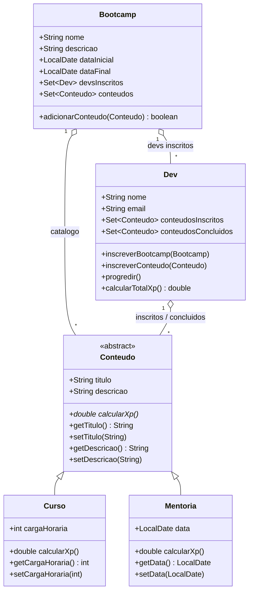

# Abstraindo um Bootcamp Usando Orientação a Objetos em Java

> Desafio de projeto do bootcamp **DIO — Digital Innovation One**.
> Modelagem do domínio de bootcamps aplicando os quatro pilares da POO:
> **abstração, encapsulamento, herança e polimorfismo**.

[](https://openjdk.org/)
[](https://maven.apache.org/)
[](https://junit.org/junit5/)
[]()

---

## 1. O que é este projeto

O domínio modelado é o de um **bootcamp**: um programa que reúne conteúdos (cursos e mentorias)
e devs que se inscrevem neles, progredem de um conteúdo para o outro e acumulam XP.

O domínio foi escolhido porque ele **exige** os quatro pilares para ser modelado bem:

| Pilar | Onde aparece no código |
|---|---|
| **Abstração** | `Conteudo` é abstrata: existe o *conceito* de conteúdo, mas só se instanciam `Curso` e `Mentoria`. |
| **Encapsulamento** | Todos os atributos são `private`, acessados apenas por getters/setters; nada externo mexe no estado interno. |
| **Herança** | `Curso` e `Mentoria` estendem `Conteudo` e reaproveitam `titulo`, `descricao`, `getters` e `setters`. |
| **Polimorfismo** | `calcularXp()` é abstrato em `Conteudo` e implementado de forma diferente em cada subclasse. A mesma variável do tipo `Conteudo` devolve 80 XP para um curso e 30 XP para uma mentoria. |

---

## 2. Modelo de domínio



### Regras de XP

| Tipo | Regra | Exemplo |
|---|---|---|
| `Curso` | `XP_PADRAO (10) x cargaHoraria` | 8 horas → **80 XP** |
| `Mentoria` | `XP_PADRAO (10) + 20` de bônus | sempre **30 XP** |

---

## 3. As cinco etapas do desafio

O `Main` (`src/main/java/br/com/dio/desafio/Main.java`) percorre as etapas na ordem do enunciado,
e a saída do console serve de prova de cada conceito:

| Etapa | O que foi feito | Onde |
|---|---|---|
| **1. Abstração e encapsulamento** | Classes `Curso` e `Mentoria` com atributos privados, getters/setters e `toString()`; objetos instanciados com `new` e impressos | `Main` · `Curso` · `Mentoria` |
| **2. Herança e polimorfismo** | `Conteudo` abstrata com os atributos comuns; `calcularXp()` abstrato; `Curso` e `Mentoria` estendem `Conteudo`; uma variável do tipo `Conteudo` apontando para cada subclasse | `Conteudo` |
| **3. Abstração, encapsulamento e polimorfismo** | Criação de `Bootcamp` e `Dev`, com seus atributos e a assinatura dos métodos | `Bootcamp` · `Dev` |
| **4. Regras de negócio** | `Dev.inscreverBootcamp()`, `Dev.progredir()` e `Dev.calcularTotalXp()` implementados | `Dev` |
| **5. Interligação das classes** | `bootcamp1`, `devCamila` e `devRodolfo` instanciados, inscritos, progredindo e com XP impresso | `Main` |

### Saída real do programa

```
========================================================================
  PARTE 2 - Heranca e polimorfismo
========================================================================
Conteudo (variavel do tipo Conteudo)...
  instanceof Curso    -> true
  calcularXp()        -> 80.0
Mentoria (mesma variavel, outro tipo concreto)...
  instanceof Mentoria -> true
  calcularXp()        -> 30.0

...
Conteudos concluidos Camila: [Curso{... cargaHoraria=8}, Curso{... cargaHoraria=4}]
XP Camila: 120.0
...
Conteudos concluidos Rodolfo: [Curso{... cargaHoraria=8}, Curso{... cargaHoraria=4}, Mentoria{...}]
XP Rodolfo: 150.0
```

Repare no bloco da **Parte 2**: a variável é declarada como `Conteudo`, mas o valor devolvido por
`calcularXp()` muda conforme o tipo concreto real. É o polimorfismo em ação — e o código do
cliente não muda nada para accommodate os dois casos.

---

## 4. Como executar

Pré-requisito: **JDK 17+** e **Maven 3.9+**.

```bash
# compila e roda a demonstracao completa
mvn clean package
mvn exec:java

# so os testes
mvn test

# abre o relatorio de cobertura de testes
# target/surefire-reports/
```

Também dá para rodar direto pela IDE: `Main.main()` em `src/main/java/br/com/dio/desafio/Main.java`.

---

## 5. Testes

**18 testes automatizados** (JUnit 5), cobrindo os quatro pilares e as regras de negócio:

| Classe de teste | Cobertura | Testes |
|---|---|---|
| `ConteudoTest` | abstração, encapsulamento, herança, polimorfismo e `equals`/`hashCode` | 5 |
| `ConteudosConcretosTest` | regra de XP de `Curso` e de `Mentoria`, `toString` | 3 |
| `BootcampTest` | catálogo, período de 45 dias, inscrição e identidade | 4 |
| `DevTest` | inscrição, progressão, XP total, inscrição avulsa e identidade | 5 |
| `MainTest` | teste de fumaça: o `main` roda de ponta a ponta e imprime todas as etapas | 1 |

```
Tests run: 18, Failures: 0, Errors: 0, Skipped: 0
BUILD SUCCESS
```

---

## 6. Estrutura do projeto

```
dio-poo-java-bootcamp/
├── pom.xml
├── README.md
├── .gitignore
└── src/
    ├── main/java/br/com/dio/desafio/
    │   ├── Main.java                          # demonstracao das 5 etapas
    │   └── dominio/
    │       ├── Conteudo.java                  # superclasse abstrata
    │       ├── Curso.java                     # subclasse concreta
    │       ├── Mentoria.java                  # subclasse concreta
    │       ├── Bootcamp.java                  # agrega conteudos e devs
    │       └── Dev.java                       # regras de negocio do dev
    └── test/java/br/com/dio/desafio/
        ├── MainTest.java
        └── dominio/
            ├── ConteudoTest.java
            ├── ConteudosConcretosTest.java
            ├── BootcampTest.java
            └── DevTest.java
```

---

## 7. Decisões de projeto

Além de reproduzir o enunciado, o projeto toma algumas decisões de engenharia que valem
registro:

1. **`equals`/`hashCode` baseados apenas em atributos imutáveis.**
   A implementação de referência do exercício compara `Dev` e `Bootcamp` incluindo os conjuntos
   `conteudosInscritos` e `devsInscritos`. Isso é um defeito: como esses conjuntos são mutáveis
   e mudam a cada `progredir()`, o `hashCode` de um objeto já inserido em um `HashSet` mudaria
   depois — o objeto ficaria inalcançável no set. Aqui, `Dev` se identifica pelo `nome`,
   `Bootcamp` pelo par `nome`/`descricao` e `Conteudo` pelo par `titulo`/`descricao`, com
   verificação de classe concreta (`getClass() != o.getClass()`) para que um `Curso` nunca seja
   igual a uma `Mentoria` com os mesmos textos.

2. **`XP_PADRAO` e o bônus de mentoria como constantes nomeadas.**
   O valor `10` e o bônus `20` viraram `XP_PADRAO` e `BONUS_MENTORIA`, para que a regra de XP
   fique explícita no código em vez de implícita em literais soltos.

3. **Construtores parametrizados convémios, sem remover os vazios.**
   A implementação de referência usa `new` seguido de `setters`. Esse padrão foi mantido (é o
   que o exercício ensina), mas cada classe ganhou também um construtor completo, o que deixa o
   código de teste e de produção mais enxuto.

4. **`Set` em vez de `List` para os conteúdos.**
   Um conteúdo é único dentro de um bootcamp; `LinkedHashSet` garante unicidade e preserva a
   ordem de inserção, o que torna a sequência de `progredir()` previsível.

5. **`Optional` na progressão.**
   `Dev.progredir()` usa `stream().findFirst()` com `Optional`, em vez de indexar a lista
   diretamente — evita `IndexOutOfBoundsException` e deixa a intenção explícita.

6. **Javadoc completo em português.**
   Cada classe e método público documenta o papel no domínio e o pilar de POO que está
   exercitando.

---

## 8. Autor

**MissDev** — [github.com/MissDev-glitch2](https://github.com/MissDev-glitch2)

---

## Licença

MIT — veja o bloco `licenses` no `pom.xml`.
